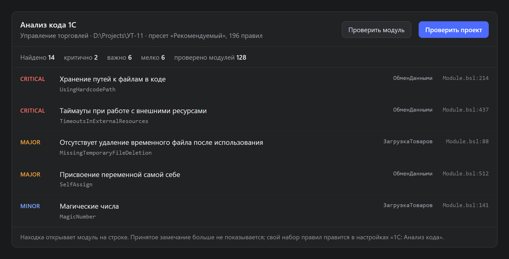

<h1 align="center">
  
  <br />
  DSH для 1С
</h1>

<p align="center">
  <a href="https://github.com/Mempemp/DSH-1C-deskop-bundle/releases/latest"></a>
  
  
</p>

<p align="center">
  <a href="https://github.com/Mempemp/DSH-1C-deskop-bundle/releases/latest">Скачать</a> ·
  <a href="#быстрый-старт">Быстрый старт</a> ·
  <a href="#что-внутри">Возможности</a> ·
  <a href="#проверка-кода">Анализ кода</a> ·
  <a href="#состав-сборки">Состав</a> ·
  <a href="#сборка-из-исходников">Сборка</a> ·
  <a href="#благодарности">Благодарности</a>
</p>

<p align="center">
  Рабочее место разработчика 1С с ИИ-агентом внутри:<br />
  редактор BSL с деревом метаданных, подключение к базе, проверка кода по 210 правилам 1С<br />
  и справка по API вашей платформы — в одном окне на Windows.
</p>

Скачали `.exe`, запустили, указали базу — работаете. Агент видит код вашей конфигурации, метаданные
и стандарты ИТС, предлагает правку в модуле и проверяет результат по правилам 1С.

Версия сборки — `<версия ядра>-<номер подрелиза>`: `0.2.2-rc.1-1` — первый подрелиз на ядре
`0.2.2-rc.1`. Номер подрелиза растёт с изменениями сборки, версия ядра — с обновлением DeepSeek
Harness.

## Быстрый старт

1. **Скачайте установщик** со [страницы релизов](https://github.com/Mempemp/DSH-1C-deskop-bundle/releases/latest)
   — `DSH-1C-Setup-0.2.2-rc.1-1-win-x64-unsigned.exe`, 448 МиБ. Установщик не подписан, поэтому
   Windows покажет SmartScreen: «Подробнее» → «Выполнить в любом случае».
2. **Запустите и добавьте проект.** На первом экране доступно «Настроить позже» — рабочее
   пространство открывается без аккаунта и без ключа. Аккаунт DeepSeek и модели — в «Настройки →
   Модели». В «1С: Параметры проектов» укажите папку проекта и базу: файловую или клиент-серверную.
3. **Откройте модуль.** В дереве метаданных выберите модуль и задайте агенту вопрос по коду.

Готово, если в окне видно дерево метаданных конфигурации, а агент отвечает со ссылками на объекты
и плейбуки. Правила для агента приходят вместе с проектом: `AGENTS.md` и одиннадцать плейбуков.

## Что внутри

### Работа с кодом

- **Редактор BSL** ([DSH-CodeEditor_BSL](https://github.com/Mempemp/DSH-CodeEditor_BSL)) — дерево
  метаданных 1С, подсветка, diff, отправка фрагмента кода в чат. Переход к определению (F12) идёт по
  модели метаданных. Дерево следует за активной вкладкой: раскрывает папки, подсвечивает и ставит
  файл по центру (в «Файлах» — строку, в «Метаданных» — узел). Подсказки над кодом оформлены как
  сообщения самого DSH.
- **Правки агента по файлу** — построчный diff, «Принять» и «Отклонить» по блоку, «В индекс» и
  «Коммит» в полосе вкладок. Работает на машине без установленного Git: MinGit едет в поставке.
- **RLM-инструменты для BSL** — быстрый поиск и навигация по коду 1С: MCP-сервер `rlm-tools-bsl`
  живёт внутри [DSH-1CProjectProperties](https://github.com/Mempemp/DSH-1CProjectProperties) со
  своими настройками и индексами проектов. Индекс строится сразу после выгрузки конфигурации.
- **Рабочие области под проекты** — Платформа, ЕРП, ЗУП, прочее: разные задачи в одном окне, сессии
  не смешиваются.

### Проверка кода

- **Статический анализ** по 210 правилам (196 включены, 12 категорий) с пресетом «рекомендуемый» и
  панелью «Анализ кода 1С»: находки с важностью и переходом на строку, свои принятые замечания,
  проверка модуля или всего проекта. Движок — `bsl-analyzer` 0.4.3 (MIT), лежит в поставке; сервер
  поднимается галочкой в настройках «1С: Анализ кода». Инструменты `bsl_check_*` видны агенту как
  MCP-сервер `1c-bsl-checks`.
- **Второе мнение** — `bsl_review` смотрит модуль или дифф независимым ревьюером и отдаёт находки
  вида «критично | важно | мелко — что не так; где; к чему приведёт; как чинить».



### Подключение к базам

- **Параметры проекта 1С** ([DSH-1CProjectProperties](https://github.com/Mempemp/DSH-1CProjectProperties)) —
  путь к базе, пользователь, пароль, код доступа `/UC`, путь к платформе. Лежат в
  `.dsh/1c-project.json` в папке проекта: переезжают вместе с проектом, видны в git, доступны
  инструментам агента через роуты `/1cprops/*`.
- **Проверка подключения** — внешним соединением `V83.COMConnector` за ~3 с: платформа
  авторизуется, открывает базу на чтение и отдаёт версию конфигурации. База не блокируется,
  Конфигуратор не запускается.
- **Выгрузка конфигурации в файлы** — `DESIGNER /DumpConfigToFiles`: иерархический или плоский
  формат, режим «только изменения», снятие lock-файлов `.cfl`, ход, время, число файлов и лог.
  Обратная загрузка — `LoadConfigFromFiles` с динамическим обновлением базы.
- **Выгрузка расширений** — все расширения базы в подпапку `Extensions` рядом с конфигурацией.
- **Подсказки баз** из штатного списка 1С: пользовательский, общий и подключённый через
  `CommonInfoBases`.

### Агент и знания о 1С

- **Правила 1С в проекте** — корневой `AGENTS.md` собирает плагин: шапка с инструментами этой сборки
  и одиннадцать плейбуков в `.dsh/rules-own/` — поиск, платформа, стандарты ИТС, код, запросы,
  правка модуля, метаданные, отчёты на СКД, формы, база, ревью. Предметная часть — из набора
  [ai_rules_1c](https://github.com/comol/ai_rules_1c): транзакции и замки, индексирование временных
  таблиц, расширения и `&ИзменениеИКонтроль`, регистры, СКД, асинхронность, работа с типовым кодом.
  Изложено под инструменты этой сборки. `USER-RULES.md` — ваш файл, плагин его не трогает.
- **Документация платформы** — публичный MCP-сервер `v8std`: поиск по документации 1С, БСП / SSL и
  стандартам, разбор диагностик ACC и BSLLS. Подключён сразу, без ключа и настройки; в панели
  MCP-менеджера его видно и можно выключить, как любой другой сервер.
- **Справка по API вашей версии** — второй MCP-сервер, `1c-platform-context`, читает
  синтакс-помощник установленной 1С: сигнатуры методов, свойства типов, конструкторы, значения
  системных перечислений, проверка BSL против платформы. Поднимается, когда в настройках указан путь
  к платформе. Работает офлайн.
- **Память о работе** ([dsh-engram-memory](https://github.com/Mempemp/dsh-engram-memory)) — агент
  помнит, что делалось в каждом проекте: заметки законченных ходов, выводы модели, подача нужного в
  разговор и вкладка «Память Engram» для сведения заметок в карточки-знания. База локальная:
  `%USERPROFILE%\.engram\engram.db`.
- **Команда агентов** — встроенный набор координации прописан в профиле с первого запуска: задачу
  ведёт команда с ролями (разбор, правка, проверка). Пакет лежит в приложении.


### Второе мнение: [1С:Напарник](https://code.1c.ai)

`its_help` отвечает словами на вопросы «как принято», «почему правило такое», «какой из похожих
методов БСП выбрать». Включается токеном в настройках; квота общая с веб-версией сервиса и видна
строкой «Бюджет» — проценты и время сброса недели.

> **Только для ознакомления.** Сервис 1С:Напарник принадлежит фирме «1С», и условия его
> использования задаёт правообладатель: сервис не предназначен для встраивания в сторонние
> продукты, доступ может быть ограничен или закрыт без предупреждения. Подключение здесь
> ознакомительное — посмотреть, что даёт Напарник в работе агента, и решить, нужен ли он вам.
> Плагин ничего не проксирует, не кеширует и не хранит ответы: запрос идёт с вашей машины
> в сервис напрямую, токен и последствия его использования — на владельце машины.
> Отключается удалением токена.

### Остальное в окне

- **Документы** — просмотр docx/pptx/xlsx и конвертация Office→PDF встроены в клиент; агент создаёт
  и правит файлы через навыки office-*.
- **Веб-поиск** ([modsearch](https://github.com/liustack/modsearch)) и **схемы**
  ([archify](https://github.com/tt-a1i/archify), Mermaid).
- **Браузер для агента** ([dsh-browser-agent](https://github.com/hermes-ai-2026/dsh-browser-agent)) —
  19 инструментов `browser_*` поверх встроенного sidebar-браузера: чтение accessibility-дерева со
  стабильными ссылками, ввод через CDP, скриншоты, перехват сети, эмуляция устройств, хранилище
  cookie и несколько окон.
- **Маркет плагинов** — встроенная вкладка «Discover» ядра: сборка прописывает ей индекс сообщества,
  свои плагины и MCP добавляются поверх.
- **Русский интерфейс** ([dsh-russian-lang](https://github.com/GooDAnDReaDY/dsh-russian-lang)) —
  предвыбран; умные функции ввода (Smart UX) по умолчанию выключены и включаются галочками в настройках плагина.
- **Уведомления на русском** ([dsh-notifier-ru](packages/dsh-notifier-ru)) — системный тост Windows,
  когда агенту нужен ответ, требуется разрешение или задача закончилась (в том числе с ошибкой);
  звук, каналы ntfy / Gotify / Bark / webhook и страница настроек плагина на русском. Системный тост
  дублируется плашкой в окне, оформленной как сообщение DSH; клик по ней открывает ту сессию, о
  которой уведомление.

## Обновления и откат

- Приложение проверяет страницу релизов и ставит обновление тем же мастером, скачивая изменившуюся
  часть файла.
- Перед обновлением снимается копия данных: сессии, настройки, профиль, ключи. Хранятся три
  последние, неизменные файлы между ними переиспользуются.
- «Создать копию данных» в меню трея снимает копию в любой момент, «Восстановить из копии»
  возвращает её; перед восстановлением снимается копия текущего состояния, а файлы, появившиеся
  после копии, остаются. Там же откат на предыдущую версию установщиком.

## Требования

| Что | Значение |
| --- | --- |
| Windows | 10 или 11, x64 |
| Платформа 1С | 8.3 — для подключения к базе, выгрузки и справки по API |
| Диск | ≈1,3 ГБ после установки |
| Рантаймы | Node.js, Git, Python, Java и языковой сервер не требуются: всё нужное внутри |
| Интернет | обновления, стандарты ИТС / БСП, 1С:Напарник; остальное работает офлайн |

## Где что лежит

- Данные — профиль, сессии, настройки, вложения и ваши плагины — в `%USERPROFILE%\.dsh`; при
  обновлении они сохраняются.
- Первый запуск копирует данные прежней сборки (`%APPDATA%\dsh-desktop\harness`) в `.dsh` один раз;
  исходный каталог остаётся как есть.
- Компоненты каталога — плагины и рантаймы — ставятся при первом запуске в `%USERPROFILE%\.dsh`
  (Git — `.dsh\git`, движок проверок — `.dsh\bsl-analyzer`). Пока идёт установка, на экране
  заставка с полоской; второй клик по ярлыку поднимает её. На тёплом старте заставки не видно.

## Состав сборки

17 позиций: 11 плагинов, 5 MCP-серверов, движок поиска по коду, `uv`, MinGit, набор правил и рантайм
ядра. Источники — `installer-flavor.yml`, версии и digest — `apps/desktop/installer-catalog/manifest.json`;
полные версии, пути и размеры — [docs/состав-сборки.md](docs/состав-сборки.md).

**11 плагинов.** Четыре наших: `dsh-1c-project-properties` (параметры проекта, правила, анализ кода,
Напарник, движок проверок), `dsh-bsl-editor` (редактор BSL), `dsh-engram-memory` (память агента и
MCP-сервер `engram` внутри пакета), `dsh-notifier-ru` (русские уведомления: системный тост Windows,
звук и каналы push). Семь из сообщества: `dsh-mcp-manager` (панель MCP-серверов, локальная редакция
0.2.12), modsearch (веб-поиск), `dsh-better-sidebar` (боковая панель с браузером), skill-explorer
(навыки агента, он же `dsh-web`), archify (схемы Mermaid), `dsh-russian-lang` (русская локаль),
`dsh-browser-agent` (19 инструментов `browser_*` поверх CDP).

**5 MCP-серверов.**

- `1c-bsl-checks` — проверка кода по правилам 1С. Движок `bsl-analyzer` 0.4.3 лежит в поставке
  (`%USERPROFILE%\.dsh\bsl-analyzer`); сервера нет, пока не включена галочка в настройках.
- `v8std` — поиск по документации платформы 1С, БСП / SSL и стандартам; публичный, без ключа.
- `1c-platform-context` — справка по объектной модели **установленной** версии платформы: типы,
  методы, свойства, конструкторы, значения системных перечислений, проверка BSL против платформы.
  Локальный `bsl-context-rs` из сборки, без Java и Python: сервер поднимает
  `dsh-1c-project-properties` по пути к платформе, инструменты видны агенту как
  `mcp__1c-platform-context__*`, сервер виден в панели MCP-менеджера.
- `rlm-tools-bsl` — поиск и навигация по коду, индексы проектов; живёт в
  `dsh-1c-project-properties`.
- `engram` — память агента, внутри `dsh-engram-memory`.

**Рантаймы и payload.**

- `uv 0.13.7` — им первый запуск ставит движок `rlm-tools-bsl` из индекса, без системного Python.
- `MinGit 2.56.0.4` — тот же `git.exe`, что ставит Git for Windows, но без графического интерфейса,
  Git Bash, Perl и справки. Первый запуск распаковывает его в `%USERPROFILE%\.dsh\git`, поэтому
  редактор показывает диффы и индикаторы изменений и умеет отправлять правки в индекс и коммитить на
  машине, где Git никто не устанавливал.
- `@deepseek-ai/dsh@0.2.2-rc.1` — ядро внутри приложения: ставить Node.js и CLI не нужно.
- Набор правил [ai_rules_1c](https://github.com/comol/ai_rules_1c) офлайн-копией — источник
  предметных правил, его содержание перенесено в наши плейбуки.

## Сборка из исходников

Приложение живёт в форке DeepSeek Harness — [Mempemp/deepseek-harness](https://github.com/Mempemp/deepseek-harness),
ветка `1c/main` (она же ветка по умолчанию). Этот репозиторий держит состав каталога, редакцию
notifier и документацию, поэтому клонировать нужно оба репозитория рядом: скрипт каталога читает
`installer-flavor.yml` и `packages/dsh-notifier-ru` отсюда.

Требования: Windows x64, Node.js 24, pnpm (`corepack enable`, версия из `packageManager`),
Visual Studio Build Tools 2022 с C++.

```sh
git clone https://github.com/Mempemp/deepseek-harness.git
git clone https://github.com/Mempemp/DSH-1C-deskop-bundle.git
cd deepseek-harness
corepack enable
pnpm install --frozen-lockfile
cp apps/desktop/.env.windows.1c apps/desktop/.env.windows
node apps/desktop/scripts/prepare-1c-catalog.mjs
pnpm --dir apps/desktop run package:win:x64:unsigned
```

Готовое — в `apps/desktop/.desktop-build/targets/win-x64/unsigned-artifacts/`: установщик, `.blockmap`
и `dsh1c.yml`. Каталог собирается из сети (npm, git, локальные пути) и в репозиторий не коммитится;
если он лежит не рядом с форком, путь задаётся `DSH_1C_BUNDLE_ROOT`. Сборка идёт под TTY: без
терминала pnpm падает с `stdin is not a tty`. Собирать из PowerShell или cmd: в git-bash первым в
PATH оказывается GNU `tar`, и упаковка падает на `Cannot connect to D:`, а шимы `corepack` ломаются
на путях.

### Кэш загрузок каталога

Самый долгий шаг сборки каталога — загрузка архива `dsh-web` (около 800 МБ, растёт от ревизии к
ревизии). Архивы источников, закреплённых **коммитом**, скрипт складывает в
`%LOCALAPPDATA%\dsh-1c-catalog\downloads` и переиспользует между прогонами: первый прогон после
смены пина качает, следующие печатают `download cache hit` и проходят за минуты.

- Другой каталог кэша — переменная `DSH_1C_CATALOG_CACHE`. Содержимое можно удалить в любой момент:
  там только скачанные архивы, ничто другое от них не зависит.
- **Теги и ветки не кэшируются**: сдвинувшийся тег дал бы следующему прогону старое дерево под
  правильным именем. Меняете пин с коммита на тег — платите повторной загрузкой.
- Оборванная запись кэша распознаётся по записи конца центрального каталога и перекачивается сама,
  поэтому «странный» результат после обрыва сети лечится повтором, а не чисткой.
- Кэш не влияет на поставку: содержимое тарболов и манифест те же, что и без него — он экономит
  только трафик и время.

Инженерная документация: [архитектура](docs/architecture.md), [разработка](docs/development.md),
[релизный процесс](docs/release-runbook.md), [переезд на официальный десктоп](docs/official-desktop-migration.md).

## Вопросы и обратная связь

Ошибки и предложения — в [issues](https://github.com/Mempemp/DSH-1C-deskop-bundle/issues). К отчёту
приложите версию сборки, шаги до ошибки и журнал из `%USERPROFILE%\.dsh\logs`.

## Благодарности

Проект построен на открытых разработках, и мы благодарны их авторам:

- [DeepSeek Harness](https://github.com/deepseek-ai/deepseek-harness) — агентный рантайм и
  десктопный клиент (MIT): основа сборки, которую мы развиваем форком, добавляя русскую оболочку,
  каталог компонентов и установщик;
- [dsh-russian-lang](https://github.com/GooDAnDReaDY/dsh-russian-lang) — русская локализация интерфейса;
- [dsh-market](https://github.com/dsh-market/dsh-market) — индекс сообщества для вкладки «Discover»;
- плагины [wingsky-1](https://github.com/wingsky-1/dsh-plugin-hub),
  [liustack](https://github.com/liustack/modsearch),
  [omdsh-dev](https://github.com/omdsh-dev/DSH-better-sidebar),
  [tt-a1i](https://github.com/tt-a1i/archify),
  [zhu1090093659](https://github.com/zhu1090093659/dsh-web);
- [dsh-browser-agent](https://github.com/hermes-ai-2026/dsh-browser-agent) — браузерные инструменты
  для агента поверх встроенного sidebar-браузера (MIT);
- [dsh-notifier](https://github.com/wingsky-1/dsh-plugin-hub) — уведомления о ходе работы агента:
  системный тост Windows, звук и каналы ntfy / Gotify / Bark / webhook. В сборке едет русская
  редакция `dsh-notifier-ru` (MIT, © wingsky-1);
- [dsh-mcp-manager](https://github.com/wingsky-1/dsh-plugin-hub) — панель MCP-серверов. В сборке едет
  локальная редакция 0.2.12 ([`packages/dsh-mcp-manager`](packages/dsh-mcp-manager/README.md), MIT,
  © wingsky-1): исправлена очередь записи каталога инструментов, из-за которой хост падал по OOM
  на нескольких MCP-серверах;
- [v8std](https://v8std.ru/) — публичный MCP-сервер стандартов разработки 1С
  ([исходники](https://github.com/zeegin/v8std)): поиск по стандартам, БСП / SSL и документации
  платформы, разбор диагностик ACC и BSLLS;
- [bsl-context](https://github.com/Regsorm/bsl-context) — MCP-сервер справки по API платформы 1С
  (MIT): поставляется в сборке готовым бинарником;
- [engram](https://github.com/Gentleman-Programming/engram) — память агента (MIT, Go, автор Alan
  Buscaglia): входит в сборку внутри плагина
  [dsh-engram-memory](https://github.com/Mempemp/dsh-engram-memory);
- [bsl-analyzer](https://github.com/itrous/bsl-analyzer) — движок статического анализа BSL (MIT):
  лежит в поставке и работает через MCP-сервер `1c-bsl-checks`;
- [uv](https://github.com/astral-sh/uv) (MIT / Apache-2.0) и
  [Git for Windows](https://github.com/git-for-windows/git) (GPL-2.0, MinGit) — рантаймы в поставке:
  первый ставит движок поиска по коду, второй даёт редактору диффы и коммиты;
- набор правил [comol/ai_rules_1c](https://github.com/comol/ai_rules_1c) — источник предметных
  правил: лежит в сборке офлайн, его содержание перенесено в наши плейбуки.

## Лицензия

MIT — см. [LICENSE](LICENSE). DeepSeek Harness и остальные зависимости подчиняются своим лицензиям.
