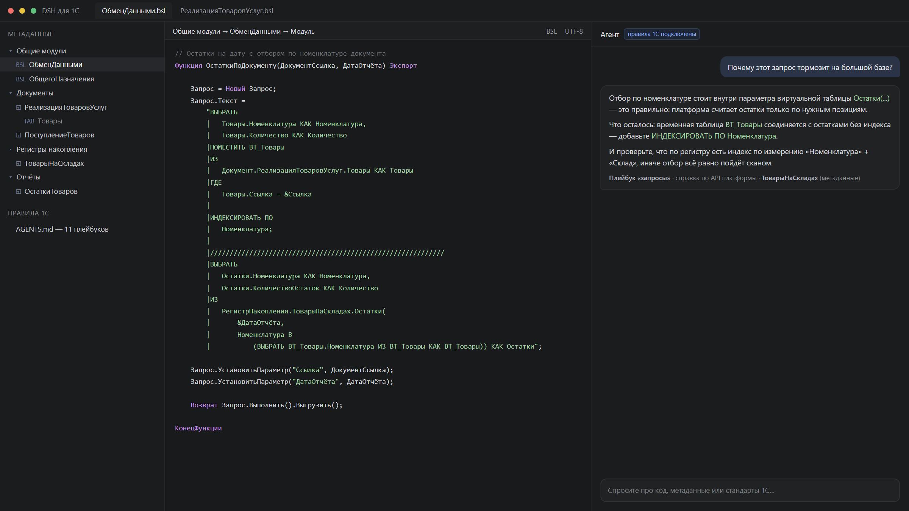
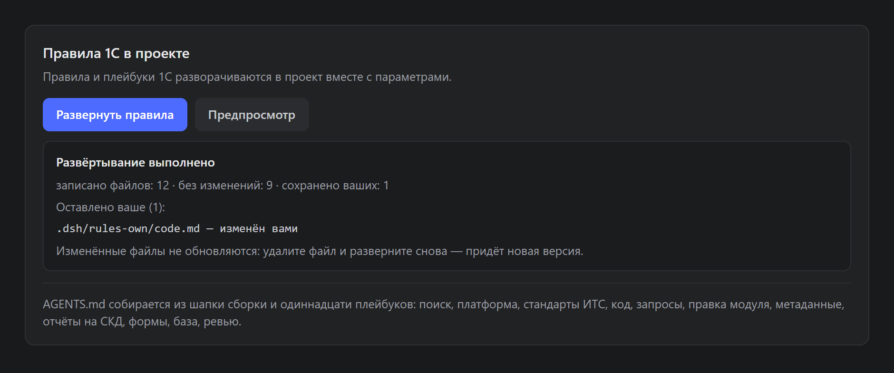

<h1 align="center">
  
  <br />
  DSH для 1С
</h1>

<p align="center">
  <a href="https://github.com/Mempemp/DSH-1C-deskop-bundle/releases/latest"></a>
  <a href="https://github.com/Mempemp/DSH-1C-deskop-bundle/releases"></a>
  
</p>

**Рабочее место разработчика 1С с ИИ-агентом внутри.** Редактор BSL с деревом метаданных,
подключение к базе, проверка кода по 210 правилам 1С и справка по API вашей платформы — в одном
окне на Windows.

Скачали `.exe`, запустили, указали базу — работаете. Агент видит код вашей конфигурации,
метаданные и стандарты ИТС, предлагает правку в модуле и проверяет результат по правилам 1С.



<p align="center"><i>Модуль BSL, дерево метаданных конфигурации и агент, который ссылается на плейбук, справку по API и объект метаданных.</i></p>

## Быстрый старт

1. **Скачайте установщик** со [страницы релизов](https://github.com/Mempemp/DSH-1C-deskop-bundle/releases/latest)
   — `DSH-1C-Setup-0.2.2-rc.1-1-win-x64-unsigned.exe`, 448 МиБ. Установщик не подписан, поэтому
   Windows покажет SmartScreen: «Подробнее» → «Выполнить в любом случае».
2. **Запустите и добавьте проект.** На первом экране доступно «Настроить позже» — рабочее
   пространство открывается без аккаунта. Аккаунт DeepSeek и модели — в «Настройки → Модели».
   В «1С: Параметры проектов» укажите папку проекта и базу: файловую или клиент-серверную.
3. **Откройте модуль.** В дереве метаданных выберите модуль и задайте агенту вопрос по коду.

Готово, если в окне видно дерево метаданных конфигурации, а агент отвечает со ссылками на объекты
и плейбуки. Правила для агента приходят вместе с проектом: `AGENTS.md` и одиннадцать плейбуков.

## Что внутри

**Пишете код**

- Дерево метаданных рядом с кодом: «Файлы» и «Метаданные» следуют за активной вкладкой.
- Переход к определению по `F12` идёт по модели метаданных.
- Диффы правок агента по файлу: «В индекс» и «Коммит» работают на машине без установленного Git.
- Подсвеченный фрагмент уходит в чат одной кнопкой.

**Проверяете код**

- Модуль или весь проект по 210 правилам 1С: 196 включены, 12 категорий, пресет «рекомендуемый».
- Находки с важностью и переходом на строку: критично, важно, мелко.
- Свои принятые замечания и свой набор правил под проект.


<p align="center"><i>Проверка проекта: что нарушено, в каком модуле и на какой строке.</i></p>

**Подключаетесь к базе**

- Параметры ИБ живут в проекте (`.dsh/1c-project.json`): файловая или клиент-серверная, пользователь,
  код доступа, путь к платформе.
- «Проверить подключение» — внешним соединением за ~3 с, конфигурацию не блокирует.
- Выгрузка конфигурации и всех расширений в XML, индекс поиска по коду сразу после выгрузки.
- Подсказки баз из штатного списка 1С: пользовательский, общий и подключённый через `CommonInfoBases`.

**Работаете с агентом**

- Правила 1С для агента: транзакции и блокировки, временные таблицы и индексы, СКД, формы,
  расширения и `&ИзменениеИКонтроль`, правка типового кода — одиннадцать плейбуков.
- Справка по API именно вашей версии платформы и стандарты ИТС / БСП — в ответе агента, со ссылкой
  на источник.
- Команда агентов с ролями (разбор, правка, проверка) включена с первого запуска.
- Память проекта: агент помнит, что уже сделано. Уведомления на русском, в том числе системным тостом.

## Требования

| Что | Значение |
| --- | --- |
| Windows | 10 или 11, x64 |
| Платформа 1С | 8.3 — для подключения к базе, выгрузки и справки по API |
| Диск | ≈1,3 ГБ после установки |
| Дополнительные рантаймы | не требуются: Node.js, Git, Python, Java идут в поставке или не нужны |
| Интернет | для обновлений, поиска по стандартам ИТС / БСП и 1С:Напарника; остальное работает офлайн |

## Правила 1С для агента

Плагин собирает в проекте корневой `AGENTS.md`: шапка с инструментами этой сборки и одиннадцать
плейбуков в `.dsh/rules-own/` — поиск, платформа, стандарты ИТС, код, запросы, правка модуля,
метаданные, отчёты на СКД, формы, база, ревью. `USER-RULES.md` — ваш файл, плагин его не трогает.

Предметная часть — из набора [comol](https://github.com/comol/ai_rules_1c), переписанная под
инструменты сборки. Развёртывание идемпотентно: неизменённые файлы не переписываются, правленый
файл остаётся вашим, отчёт показывает, что записано.



<p align="center"><i>Отчёт развёртывания: что записано, что осталось без изменений, что сохранено вашим.</i></p>

## Второе мнение: 1С:Напарник

`its_help` отвечает словами на вопросы «как принято», «почему правило такое», «какой из похожих
методов БСП выбрать». `bsl_review` смотрит модуль или дифф независимым ревьюером. Включается
токеном в настройках; квота видна строкой «Бюджет».

> **Только для ознакомления.** Сервис 1С:Напарник принадлежит фирме «1С», и условия его
> использования задаёт правообладатель: сервис не предназначен для встраивания в сторонние
> продукты, доступ может быть ограничен или закрыт без предупреждения. Подключение здесь
> ознакомительное — посмотреть, что даёт Напарник в работе агента, и решить, нужен ли он вам.
> Плагин ничего не проксирует, не кеширует и не хранит ответы: запрос идёт с вашей машины
> в сервис напрямую, токен и последствия его использования — на владельце машины.
> Отключается удалением токена.

## Обновления и откат

- Приложение проверяет страницу релизов и ставит обновление тем же мастером, скачивая изменившуюся
  часть файла.
- Перед обновлением снимается копия данных: сессии, настройки, профиль, ключи. Хранятся три
  последние, неизменные файлы между ними переиспользуются.
- «Создать копию данных» в меню трея снимает копию в любой момент, «Восстановить из копии»
  возвращает её; файлы, появившиеся после копии, остаются. Там же — откат на предыдущую версию
  установщиком.

## Ограничения

- Windows x64. Сборки для macOS и Linux нет.
- Установщик без цифровой подписи: SmartScreen предупреждает при каждом запуске нового файла.
- 1С:Напарник требует токен и доступ к `code.1c.ai`; без него `its_help` и `bsl_review` не работают,
  остальное — работает.
- Проверка кода — правила `bsl-analyzer`; собственные проверки проекта добавляются набором правил,
  а не кодом плагина.

## Что лежит внутри

17 позиций каталога: 11 плагинов, 5 MCP-серверов, движок поиска по коду, `uv`, MinGit,
набор правил и рантайм ядра. Версии, пути и размеры — [docs/состав-сборки.md](docs/состав-сборки.md).

<details>
<summary>Сборка из исходников</summary>

Приложение живёт в форке DeepSeek Harness — [Mempemp/deepseek-harness](https://github.com/Mempemp/deepseek-harness),
ветка `1c/main`. Этот репозиторий держит состав каталога, редакцию notifier и документацию,
поэтому клонировать нужно оба репозитория рядом.

Требования: Windows x64, Node.js 24, pnpm (`corepack enable`), Visual Studio Build Tools 2022 с C++.

```sh
git clone https://github.com/Mempemp/deepseek-harness.git
git clone https://github.com/Mempemp/DSH-1C-deskop-bundle.git
cd deepseek-harness
corepack enable
pnpm install --frozen-lockfile
cp apps/desktop/.env.windows.1c apps/desktop/.env.windows
node apps/desktop/scripts/prepare-1c-catalog.mjs
pnpm --dir apps/desktop run package:win:x64:unsigned
```

Готовое — в `apps/desktop/.desktop-build/targets/win-x64/unsigned-artifacts/`: установщик, `.blockmap`
и `dsh1c.yml`. Каталог собирается из сети и в репозиторий не коммитится; путь к нему задаётся
`DSH_1C_BUNDLE_ROOT`. Сборка идёт под TTY; архивы источников кэшируются в
`%LOCALAPPDATA%\dsh-1c-catalog\downloads` (`DSH_1C_CATALOG_CACHE` — другой каталог).

Инженерная документация: [архитектура](docs/architecture.md), [разработка](docs/development.md),
[релизный процесс](docs/release-runbook.md).

</details>

## Вопросы и обратная связь

Ошибки и предложения — в [issues](https://github.com/Mempemp/DSH-1C-deskop-bundle/issues). К отчёту
приложите версию сборки, шаги до ошибки и журнал из `%USERPROFILE%\.dsh\logs`.

## Благодарности

Сборка построена на [DeepSeek Harness](https://github.com/deepseek-ai/deepseek-harness) (MIT) и открытых
плагинах сообщества: [dsh-russian-lang](https://github.com/GooDAnDReaDY/dsh-russian-lang),
[modsearch](https://github.com/liustack/modsearch), [better-sidebar](https://github.com/omdsh-dev/DSH-better-sidebar),
[archify](https://github.com/tt-a1i/archify), [dsh-browser-agent](https://github.com/hermes-ai-2026/dsh-browser-agent),
[engram](https://github.com/Gentleman-Programming/engram), [v8std](https://github.com/zeegin/v8std),
[bsl-context](https://github.com/Regsorm/bsl-context), [bsl-analyzer](https://github.com/itrous/bsl-analyzer),
[ai_rules_1c](https://github.com/comol/ai_rules_1c). Полный список с лицензиями —
[docs/состав-сборки.md](docs/состав-сборки.md) и [LICENSE](LICENSE).

## Лицензия

MIT — см. [LICENSE](LICENSE).
