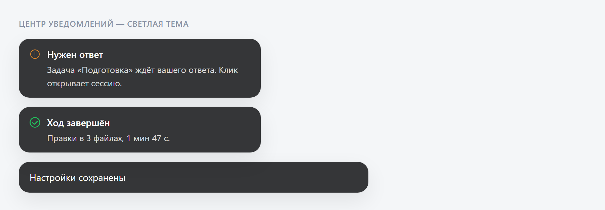
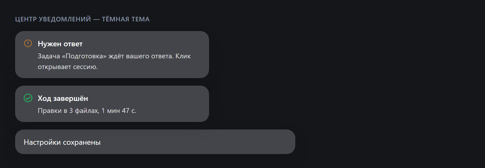
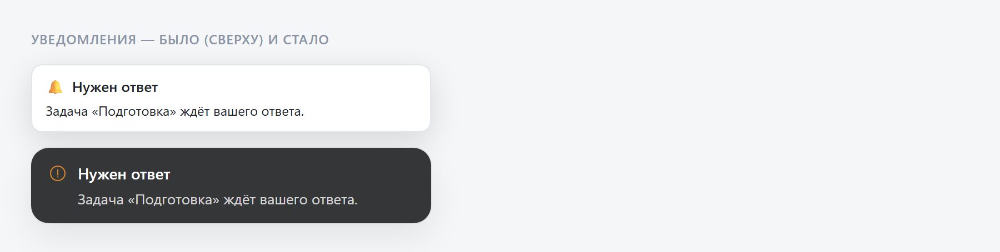

# 0.2.2-rc.1-1

Каталог и установщик для ядра `0.2.2-rc.1`. Это первый подрелиз на новой линии ядра, поэтому
сборка несёт не только правки плагинов, но и то, что принесло само обновление DeepSeek Harness.

Главное: правила 1С теперь разворачиваются нашим слоем (comol стал необязательным флажком),
появились проверка кода по 210 правилам и подключение к 1С:Напарнику, редактор избавился от
языкового сервера, а плашки редактора и уведомлений выглядят как сообщения самого DSH.

## Ядро 0.2.2-rc.1

Что изменилось в самом приложении и видно без плагинов:

- вёрстка под узкие окна, планшеты и экранную клавиатуру: меню и кнопки остаются доступными;
- выделенный текст можно вставить в поле ввода цитатой — после отправки он показывается компактной
  превью;
- историю сессии можно скопировать целиком как Markdown, вместе с путями к журналам;
- единое контекстное меню (правая кнопка и клавиатура) для сессий, рабочей области и сайдбара;
- предпросмотр файлов с постоянным деревом каталогов и переходом к файлу;
- управление плагинами: подробное описание, обновление сторонних пакетов, откат при неудачном
  обновлении;
- уведомления о фоновых задачах приходят вместе с небольшим выводом задачи;
- экономия трафика на удалённом подключении (сжатие, ответы `304` на неизменившиеся ресурсы).

В этой линии апстрим добавил свои переводы интерфейса, включая русский. Наш пакет русского
интерфейса остаётся в сборке и перекрывает переводы апстрима: проверяйте язык именно на собранной
версии, а не по манифесту.

## Правила 1С в проекте: свой слой вместо чужого

До этой сборки в проект разворачивались правила comol целиком: корневой `AGENTS.md` на 11 КБ,
построенный вокруг девяти MCP-серверов comol, которых в сборке нет, плюс 367 файлов дерева —
правила, роли, команды, навыки, OpenSpec. Модель получала инструкцию «сначала иди в инструменты,
которых нет», и это было видно в логах сессий.

Теперь в проект всегда разворачиваются наши правила, а comol стал необязательной добавкой.

**Что разворачивается всегда** (кнопка «Развернуть правила» в окне параметров проекта):

- корневой `AGENTS.md` — шапка с инструментами этой сборки (`rlm`, `1c-platform-context`, `v8std`,
  нативные файлы и оболочка), таблица «задача → плейбук» и шесть жёстких правил;
- девять плейбуков в `.dsh/rules-own/`: поиск, справка по платформе, стандарты ИТС, код, правка
  модуля, метаданные, формы, база, ревью;
- `USER-RULES.md` — файл владельца проекта, создаётся один раз и дальше не перезаписывается;
- `.dsh/rules-own/environment.md` — что где лежит и какие MCP реально настроены в этой установке.

**Флажок «Добавить правила comol»** дополнительно кладёт дерево comol (`.dsh/rules-1c/`,
`.dsh/agents-1c/`, `.dsh/commands-1c/`, `.dsh/skills/`, `openspec/`, `.dev.env`) и короткий блок о
нём в `AGENTS.md`. Он нужен тем, кто ставит MCP-серверы comol: без них часть его правил уходит в
резервные ветки.

**Корневой `AGENTS.md` остаётся нашим в любом режиме**: собственный `AGENTS.md` comol лежит в
`.dsh/rules-1c/AGENTS.md` как справочник, в корень он больше не вставляется.

**Повторное развёртывание** идемпотентно: неизменённые файлы пропускаются, изменённые вами
остаются и попадают в отчёт как сохранённые; прежний `AGENTS.md` (если он был до нас) уезжает в
`AGENTS.md.bak.md` и вклеивается в `USER-RULES.md` между маркерами.

**Снятый флажок ничего не удаляет** — он означает «больше не разворачивать»; файлы comol остаются,
наш слой обновляется. Удаление развёрнутого — отдельная команда, и она тоже сохраняет
`USER-RULES.md` и всё, что вы правили руками.

**Номера стандартов в правилах не хранятся:** `code.md` ссылается на темы, а номер стандарта — это
ответ `v8std` в момент запроса. Если сервис недоступен, плейбук говорит «стандарт не проверял», а не
подставляет правдоподобный номер.

## Проверка кода 1С

В настройках появился раздел «1С: Анализ кода», в интерфейсе — панель «Анализ кода 1С»: находки по
проекту или по модулю, переход на строку, свои принятые замечания.

- Каталог правил — 210 правил (196 включено, 12 категорий) с пресетом «рекомендуемый».
- Движок `bsl-analyzer` (MIT) **не входит в сборку**: скачивается при первом включении галочки;
  пока она снята, ничего не качается и процессы не запускаются.
- Агенту правила видны как MCP-сервер `1c-bsl-checks` (проверить фрагмент или файлы, что осталось,
  что принято, список проектов).
- Проверка на выгрузке: 551 модуль — 2,8 с на пресете, 11,6 с на полном наборе; повторная проверка
  одного файла в поднятом движке — 91 мс.

## 1С:Напарник

В той же вкладке — токен, состояние сервера `1c-naparnik` и строка «Бюджет» (окно 5 часов, неделя,
время сброса). Наружу выходит один инструмент `its_help`: вопросы «как принято», «почему правило
такое», «какой из похожих методов БСП выбрать». Ответ приходит текстом, а не эскейпленным JSON, а
служебные блоки поиска ИТС свёрнуты в одну строку «Источник: …» (−32 % знаков на реальном ответе).

Плюс `bsl_review` — второе мнение по модулю или диффу через публичный API. Пустой ответ
повторяется один раз; если и повтор пуст, инструмент отвечает «второе мнение не получено», а не
«чисто».

Подключение ознакомительное: сервис принадлежит фирме «1С», плагин ничего не проксирует, не кеширует
и не хранит ответы — запрос идёт с вашей машины напрямую, токен и последствия его использования на
владельце машины. Без токена инструмент отсутствует, остальные работают как обычно.

## Редактор: без языкового сервера

- `bsl-language-server` вырезан целиком: клиент по WebSocket, диагностика, автодополнение, hover,
  форматирование, настройки (переключатель, порт, путь к exe), роуты `/bsl/lsp-*`. Java и внешний
  сервер больше не нужны.
- F12 по-прежнему работает — по модели метаданных: «[Коллектор.]Модуль.Метод» разрешается точно,
  остальное ищется по имени, повторное нажатие перебирает кандидатов.
- Кнопка «Показать в дереве» нашла файл: пути сравниваются в одной форме, строка ставится по центру
  видимой области (в «Метаданных» — соответствующий узел, иначе переход в «Файлы»).
- Дерево следует за активной вкладкой: при переключении раскрывает папки до файла, подсвечивает и
  ставит строку по центру; закрытие активной вкладки передаёт эстафету соседней. Центровка — в той
  области, что на экране: в «Метаданных» узел, в «Файлах» строка. Файл вне корня проекта и активный
  поиск по дереву его не двигают.
- Активный файл помечен полосой 3 px и подкраской фоном.
- Контекстное меню на русском и короче: Вырезать, Копировать, Вставить · Скопировать путь модуля,
  Добавить к обсуждению, Показать в дереве. Отмена, поиск, замена и переход к строке остались
  горячими клавишами.

## Проверка кода без докачки и маркет без отдельного плагина

Два места, где раньше требовалось действие человека или лишний компонент.

- **Движок проверки кода `bsl-analyzer` 0.4.3 едет в установщике.** Раньше в окне «1С: Анализ кода»
  висела кнопка «Скачать bsl-analyzer» и пометка «один раз, около 76 МБ»: чтобы получить проверки,
  нужно было самому сходить в интернет. Теперь движок лежит в поставке
  (`%USERPROFILE%\.dsh\bsl-analyzer`), плагин сверяет его sha256 и запускает — проверки работают с
  первого запуска и без сети. Кнопка скачивания осталась только выходом для установки плагина
  вручную, мимо установщика.
- **Маркет плагинов — встроенный, отдельного плагина нет.** В ядре 0.2.2 появилась вкладка
  «Discover»: она показывает каталог сообщества и ставит плагины. Своего индекса у неё нет, поэтому
  сборка прописывает ей индекс сообщества в профиль при первом запуске — каталог тот же, а
  `dshmarket` из поставки убран (минус один компонент, который надо обновлять вместе с ядром).

## Плашки редактора и уведомлений

Обе плашки в сборке теперь выглядят как сообщение самого DSH: тёмная поверхность в обеих темах,
крупный радиус, мягкая тень, строка 14/22 и значок слева. Раньше это были светлые карточки с
рамкой.

- Значок говорит, что произошло: зелёная галочка — действие выполнено, круг с восклицательным
  знаком — не вышло или сначала нужно что-то сделать; у уведомлений есть ещё колокол для служебных
  событий.
- Действие в карточке («Перезагрузить с диска») стало синим текстом в строку, кнопки с фоном нет.
- **Клик по уведомлению открывает ту сессию**, о которой оно: раньше плашка только закрывалась.
  Системный тост Windows вёл в сессию и раньше — эта цепочка не менялась.
- Автоскрытие через 5 секунд, крестик и карточка «Файл изменён на диске», которая ждёт решения
  человека, остались как были.

Было (сверху) и стало (снизу):

Подсказки редактора — та же поверхность:

## Каталог и зависимости

Подтянуто вместе с обновлением ядра (аудит орбиты — в конце файла): сайдбар,
обозреватель навыков, веб-поиск, русский интерфейс, комплектный Git, `uv`. Локальные редакции
менеджера MCP и уведомлений пересобраны на апстрим, собранный под это ядро: у прежних сборок
хост-пиры называли точную версию ядра, и на новой линии приложение отвергало плагин целиком —
панель MCP и уведомления просто исчезли бы.

## Это обновление, а не переустановка

Мастер ставит новую версию поверх: настройки, ключи провайдеров, рабочие области, сессии, профили
плагинов и память агента остаются на месте. Каталог поставки переустанавливается сам — версии
плагинов из сборки обновляются, а то, что вы поставили себе из маркета, сборка не трогает.

Если у вас уже развёрнуты правила в проектах — они обновятся после повторного «Развернуть правила»
в окне проекта: плагин не переписывает файлы проекта сам по себе.

## SmartScreen

Установщик не подписан, поэтому Windows покажет предупреждение: «Подробнее» → «Выполнить в любом
случае». Это ожидаемо и не признак повреждения файла.

## Автообновление

Приложение проверяет свои релизы и предлагает обновиться, скачивая только изменившуюся часть файла.
Обновление приходит с этого репозитория, не с сайта апстрима: иначе установка заменила бы продукт
вместе с каталогом 1С. Канал обновлений — только Windows.

## Требования

Windows 10/11 x64. Node.js, Python и Git ставить не нужно: рантайм, комплектный Git, `uv` и движок
проверки кода `bsl-analyzer` лежат внутри приложения. Интернет нужен один раз — плагин параметров
скачивает окружение индексации (`rlm-tools-bsl`) при первом включении проверок по проекту.

## Аудит зависимостей

| Компонент | В сборке | У апстрима | Комментарий |
| --- | --- | --- | --- |
| ядро `@deepseek-ai/dsh` | 0.2.2-rc.1 | 0.2.2-rc.1 | новая линия |
| `dshmarket` | — (убран) | 1.73.12 | в ядре 0.2.2 есть вкладка «Discover»; её индекс прописывает сборка |
| `@wingsky-1/dsh-mcp-manager` | 0.2.12 (локальная редакция) | 0.2.11 | наша правка очереди записи |
| `@liustack/modsearch` | 5.10.11 | 5.10.11 | патч-версия |
| `dsh-better-sidebar` | v0.30.1 | v0.30.1 | пиры `^0.2.2-rc.1` |
| skill-explorer (`dsh-web`) | v0.4.15 | v0.4.15 | пин на коммит |
| `@tt-a1i/archify-dsh` | 1.0.0 | 1.0.0 | актуально |
| `@goodandready/dsh-russian-lang` | 0.4.22 | 0.4.22 | ядро объявлено диапазоном 0.2.2 |
| `dsh-1c-project-properties` | 0.15.1 (`5e745904`) | пин = голова | наш плагин: движок проверок из поставки |
| `dsh-bsl-editor` | 0.9.7 (`b9b18dd8`) | пин = голова | наш плагин |
| `dsh-notifier-ru` | 0.2.12 (локальная редакция) | `@wingsky-1/dsh-notifier` 0.2.11 | наш компонент |
| `dsh-browser-agent` | 1.0.1 (`a69f2ca5`) | пин = голова | наш пин |
| `dsh-engram-memory` | 0.1.5 (`f2f28e9f`) | пин = голова | наш пин |
| `1c-rules` (comol) | `2026.10.21-18e3383d` | ветка ушла вперёд | необязательный набор, пин не двигали |
| git / uv | 2.56.0.4 / 0.13.7 | 2.56.0.4 / 0.13.7 | комплектные инструменты |
| `rlm-tools-bsl` (движок индексации) | 1.47.0 | 1.49.0 | не двигали: смена схемы индекса отдельным выпуском |
| MCP `v8std` | `https://ai.v8std.ru/mcp` | — | remote, без пина |

## Сборка

| Что | Значение |
| --- | --- |
| Файл | `DSH-1C-Setup-0.2.2-rc.1-1-win-x64-unsigned.exe` |
| Размер | 451 665 063 Б (430,7 МиБ) |
| sha256 | `3a3c753f43c18beb984761fd2cf187717678aa55428719983f711c0f988149fd` |
| FileVersion / ProductVersion | `0.2.2-rc.1-1` / `0.2.2-rc.1-1` |
| Подпись | `NotSigned` — SmartScreen предупредит, это ожидаемо |
| Собрано | 06.11.2026, 13:45 (13,5 мин) |
| Манифест каталога внутри сборки | `0.2.2-rc.1-1`, 17 позиций, `skipped` пуст |
| Фид | `dsh1c.yml`: версия `0.2.2-rc.1-1`, размер и sha512 совпадают с файлом |

`latest.yml` рядом с установщиком — мост для сборок 0.11.x: версия `0.11.0-4`, тот же файл, sha512 и
размер. Лежит готовым к публикации вместе с `dsh1c.yml`.

## Проверки перед публикацией

- отдельный `DSH_HOME`: каталог применён, плагины на месте, MCP-строки видны;
- первый запуск: в журнале `catalog seeded`, `applied installer catalog <id>@<ver>`,
  `projected generations: N linked`, ни одной строки `plugin failures`;
- редактор: диффы, индикаторы изменений, «В индекс» и «Коммит» на машине без установленного Git;
- страница «1С: Параметры проектов» отвечает (в профиле нет второго владельца `/rlm/*`);
- развернуть правила в тестовом проекте, включить и снять флажок comol, повторить развёртывание;
- включить проверку кода и Напарник, посмотреть карточку «Бюджет» и появление `1c-naparnik`;
- язык интерфейса русский, тема светлая и тёмная, плашки редактора и уведомлений на месте.
